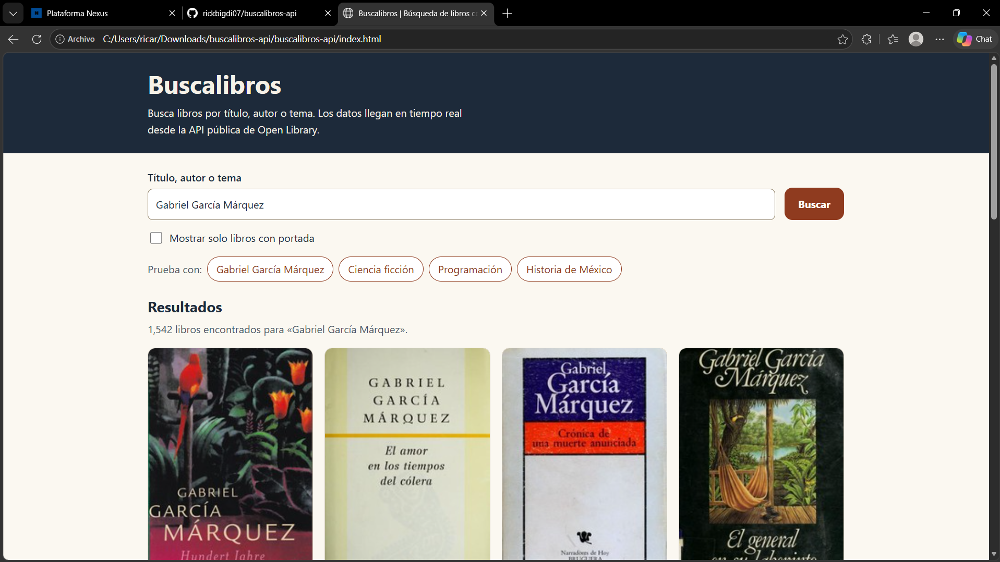
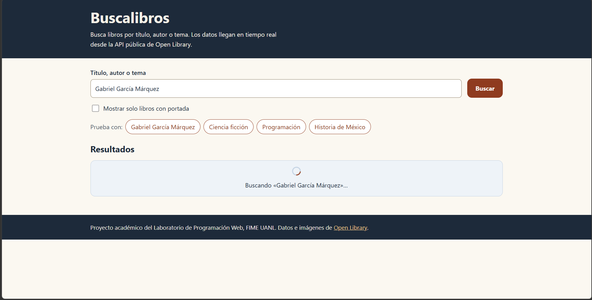
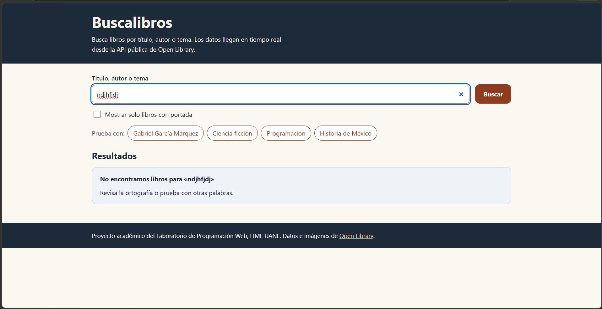
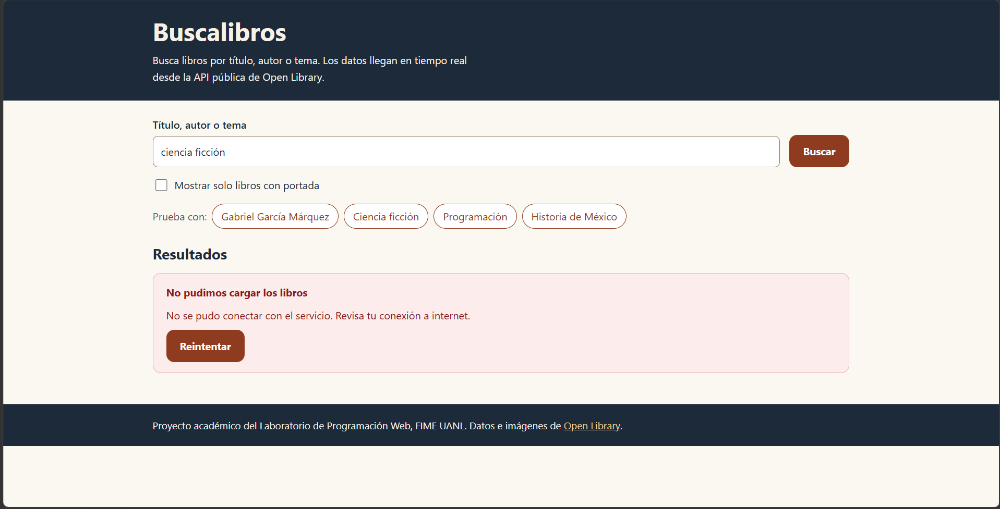
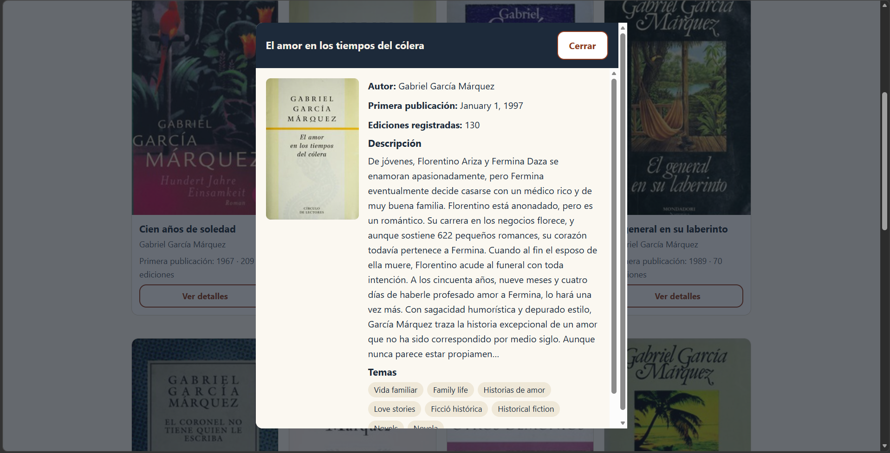
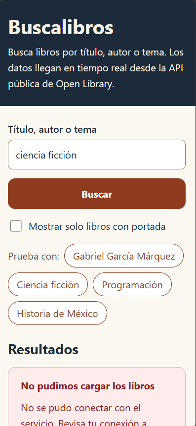

# Buscalibros

Miniaplicación web que consume la API REST pública de **Open Library** para buscar libros, mostrarlos en tarjetas creadas dinámicamente y consultar el detalle de cada uno.

Actividad 4 · Laboratorio de Programación Web 
Autores: Ricardo Adiel Cuellar Cortez y Josue Emiliano Diaz Garcia

- **Aplicación publicada:** https://rickbigdi07.github.io/buscalibros-api/
- **Repositorio:** https://github.com/rickbigdi07/buscalibros-api

## API utilizada

[Open Library](https://openlibrary.org/developers/api) es un catálogo abierto de libros mantenido por Internet Archive. Se eligió porque:

- Es pública y **no requiere clave ni registro**, así que no se maneja ningún dato sensible.
- Permite peticiones desde el navegador (CORS habilitado).
- Incluye búsqueda, paginación y portadas, lo que permite cubrir todos los requisitos de la actividad.

### Endpoints

| Uso | Método y URL | Parámetros |
|---|---|---|
| Buscar libros | `GET https://openlibrary.org/search.json` | `q` (texto), `page` (página), `limit` (resultados por página), `fields` (campos a devolver) |
| Detalle de una obra | `GET https://openlibrary.org/works/{id}.json` | `id` de la obra, por ejemplo `OL45883W` |
| Portada | `GET https://covers.openlibrary.org/b/id/{cover_i}-M.jpg` | `cover_i` de la búsqueda |

Ejemplo real usado por la aplicación:

```
https://openlibrary.org/search.json?q=borges&page=1&limit=12&fields=key,title,author_name,first_publish_year,cover_i,edition_count
```

### Formato de respuesta (JSON)

La búsqueda devuelve `numFound` (total de coincidencias) y `docs` (arreglo de libros con `key`, `title`, `author_name`, `first_publish_year`, `cover_i`, `edition_count`). Si no hay coincidencias, `numFound` es `0` y `docs` viene vacío. El detalle devuelve `description` (que puede ser texto o un objeto `{ value }`), `subjects` y otros campos.

### Códigos de error considerados

| Código / situación | Mensaje mostrado al usuario |
|---|---|
| 404 | No se encontró lo que se pidió. |
| 429 | Demasiadas consultas seguidas; esperar un momento. |
| 5xx | El servicio de Open Library no está disponible por ahora. |
| Sin conexión (fallo de red) | Revisa tu conexión a internet. |
| Más de 12 s sin respuesta | La consulta tardó demasiado. |
| Respuesta que no es JSON | La respuesta no tiene el formato esperado. |

## Funcionalidad

1. **Consumo con `fetch()` y `async/await`** en `js/api.js`, con tiempo límite de 12 s y cancelación de la petición anterior con `AbortController`.
2. **Procesamiento del JSON**: se normalizan los libros (autores, año, portada) y se descarta lo innecesario.
3. **Componentes dinámicos**: las tarjetas, la paginación y el cuadro de detalle se crean con `createElement` y `textContent` (nunca `innerHTML`), por lo que el contenido de la API no puede inyectar código.
4. **Interacción**: búsqueda por texto, búsquedas sugeridas, filtro «solo con portada», paginación y detalle del libro.
5. **Estados**: *cargando* (indicador animado), *sin resultados* (mensaje con sugerencia) y *error* (mensaje comprensible con botón **Reintentar**).
6. **Accesibilidad**: enlace para saltar al contenido, regiones `aria-live`, `role="alert"` en errores, cuadro `<dialog>` nativo cerrable con Esc y manejo del foco.
7. **Diseño responsivo** con Grid y Flexbox (2, 3 y 4 columnas según el ancho).

## Instrucciones de uso

1. Abrir la URL de la aplicación (o abrir `index.html` en el navegador; no necesita servidor ni instalación).
2. Escribir un título, autor o tema (mínimo 2 letras) y pulsar **Buscar**, o elegir una búsqueda sugerida.
3. Marcar **Mostrar solo libros con portada** para ocultar libros sin imagen.
4. Usar **Anterior / Siguiente** para cambiar de página.
5. Pulsar **Ver detalles** en una tarjeta para leer la descripción y los temas.

## Estructura del proyecto

```
index.html        Estructura semántica de la página
css/estilos.css   Estilos responsivos (mobile-first)
js/api.js         Acceso a la API: fetch, errores y normalización
js/ui.js          Creación de componentes del DOM y estados
js/app.js         Estado de la aplicación y eventos
capturas/         Capturas de pantalla para este README
```

## Capturas de pantalla

| Resultados | Estado de carga | Sin resultados |
|---|---|---|
|  |  |  |

| Error con reintento | Detalle del libro | Vista móvil |
|---|---|---|
|  |  |  |

## Pruebas realizadas

Se probó en Chrome con respuestas simuladas de la API (29 comprobaciones): carga inicial, total y paginación, filtro, detalle con descripción en texto y en objeto, estado vacío, errores 503, sin conexión y respuesta no JSON, reintento, validación del campo de búsqueda, texto con HTML mostrado como texto, ausencia de errores en consola y ausencia de desbordamiento horizontal a 375 px. Además se verificó la sintaxis de los scripts, el balance de etiquetas HTML y que todos los pares de colores cumplan contraste WCAG AA (mínimo 7:1).

## Reflexión

Lo más importante de esta actividad fue entender que consumir una API no es solo pedir datos: hay que prever todo lo que puede salir mal. Una petición tiene tiempos de espera, puede fallar por red o por el servidor, o puede devolver algo vacío, y cada caso necesita un mensaje claro para el usuario. Separar el código en tres archivos (acceso a la API, interfaz y lógica) hizo más fácil encontrar y corregir errores, porque cada parte tiene una sola responsabilidad.

Otro aprendizaje fue la cancelación de peticiones: si el usuario hace dos búsquedas seguidas, la respuesta más lenta podría pintarse encima de la más reciente, y `AbortController` junto con una verificación de la petición vigente evita ese problema. También aprendimos a construir el DOM con `textContent` en lugar de `innerHTML`, ya que los datos de una API externa no son de confianza.

Como mejora a futuro se podría guardar la última búsqueda en `localStorage`, agregar un filtro por año y ordenar los resultados.

